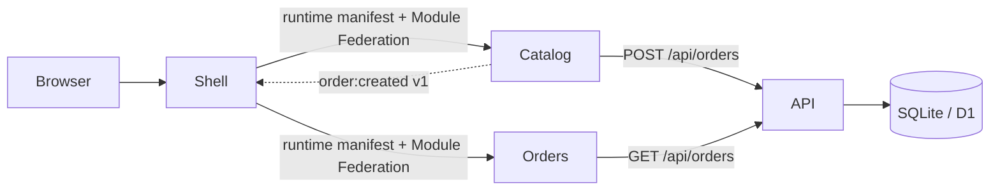

# Architecture and reading order

## Why only two remotes?

The boundary is a business capability. Catalog and Orders are enough to demonstrate independent ownership without building a distributed system for every button. The shell is intentionally small in business scope; its extra panel exists only to teach the architecture.

## Follow one order

1. The shell fetches `/api/session` and `/api/manifest` from the same origin.
2. `/catalog` selects the Catalog manifest entry. `loader.ts` registers its remote container, passes the shell's React into the federation share scope, and resolves `catalog/App` asynchronously.
3. `AppProps` passes a display-only user object and three capabilities: navigate, emit, subscribe. No token is passed to the remote.
4. Catalog fetches product rows. Its category filter uses its own `useState`.
5. An order request contains only product ID, quantity and an idempotency key. The browser sends the HttpOnly session cookie automatically. The API checks same-origin writes, looks up the session, reads the authoritative price, and inserts a user-owned row.
6. Only after success, Catalog emits `order:created` v1 with the order ID. The shell subscribes and fetches the count. The event is a notification, never the database of record.
7. Navigating to `/orders/:id` unmounts Catalog and loads Orders. Orders interprets the route suffix and requests its own data. The backend filters by both order ID and authenticated user ID.

## Public contracts

`@lab/platform` is a build-time workspace package at version 1.0.0. Its types and stateless API helper are copied into each application's build. `@lab/ui` is also build-time shared. They are not separately deployed remotes. For a larger organization, publish them as versioned packages and pin each consumer.

React is different: the shell registers its live React and ReactDOM exports with the federation runtime. Each remote requests a compatible singleton. Duplicating the small platform helpers is harmless; duplicating incompatible React hook runtimes is not.

The bus instance is created by the shell and passed through AppProps. Remotes unsubscribe on unmount. The event contract includes a version. No global Redux store or implicit `window` business object is shared.

## Routing

This tiny example uses the History API to keep the ownership boundary visible. The shell handles top-level navigation and popstate. Orders parses its own subroute. A larger app can use a router library while preserving the same ownership.

The local server and cloud shell return index.html for application deep links. Release asset requests return a real 404 when missing rather than HTML. No full-page reload is needed for navigation.

## Authentication

Passwords are salted and hashed with Web Crypto. Session tokens are 256 random bits and only their SHA-256 hashes are stored. The browser has an HttpOnly, SameSite=Lax cookie, with Secure on HTTPS. The server checks user ownership for every order request. A user prop is for presentation only and cannot grant API access.

JSON mutations require a same-origin Origin header (with one explicit localhost origin allowed during shell development). Credentials are not sent to remote asset hosts. All browser API traffic goes through the shell's same-origin `/api` path. Cloud shell-to-API communication uses a Cloudflare service binding.

## Failure behavior

A missing remote produces an actual failed network load and a rejected React.lazy promise. A surrounding error boundary keeps the shell usable. A retry creates a fresh lazy component. API errors are rendered inside the app. Module federation shares the browser's execution environment, so it is not a security sandbox.

## Deployment models

Desktop runs one Node process for simplicity. Independent builds are served from separate immutable release directories. Development uses separate Vite origins. In the cloud, API and shell have separate stable Workers, and each remote release has its own immutable Worker URL. Both environments use the same AppProps contract and backend handler.

A monorepo does not imply one release. Only the changed application's release is built, published, and promoted. Shared package changes deliberately trigger all affected pipelines. See PIPELINES.md.

## References

- [Vite features](https://vite.dev/guide/features)
- [Module Federation Vite integration](https://github.com/module-federation/vite)
- [Module Federation runtime](https://module-federation.io/guide/basic/runtime/runtime)
- [Cloudflare D1](https://developers.cloudflare.com/d1/)
